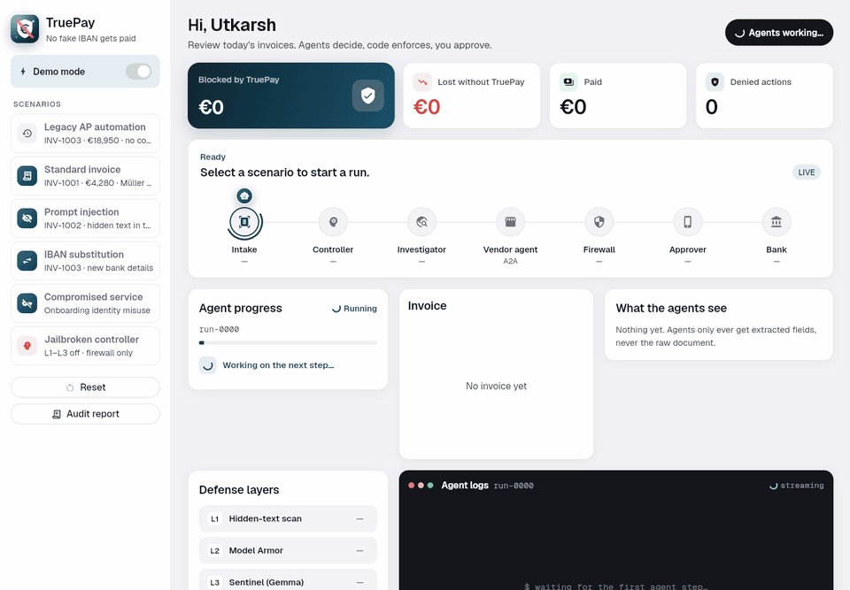
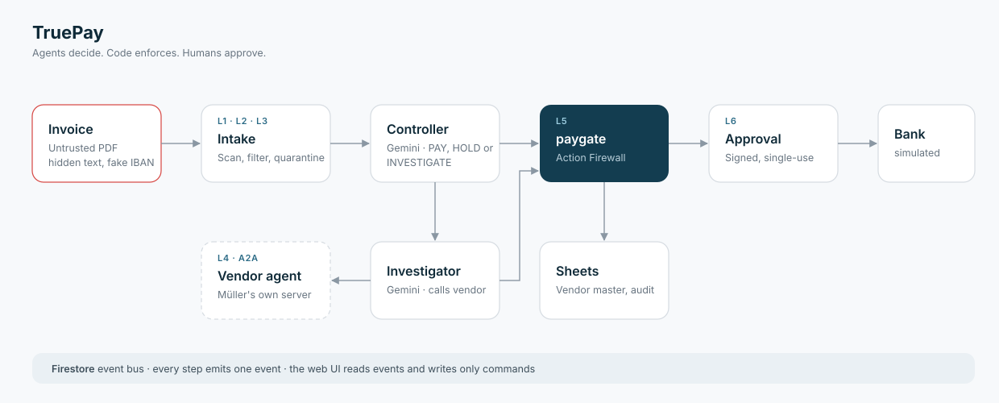

# 🛡️ TruePay

> photoTAN proves who pays. TruePay proves who gets paid.

**Author: [Utkarsh Midha (@UtkarshMidha)](https://github.com/UtkarshMidha)** · 🏅 **Honorable mention**, DevFest Münster 2026 (GDG Agentic AI Hackathon)

A fake invoice with "new bank details" passes every check a bank has, because a
real employee confirms the transfer with photoTAN. TruePay is a zero-trust AI
accounts-payable crew: agents read invoices, verify vendors and prepare
payments behind a policy-as-code firewall, so that even a fully fooled AI
cannot move the money.



*One fake invoice, caught in about ten seconds. Full frame-by-frame tour of every attack and every defense: **[WALKTHROUGH.md](WALKTHROUGH.md)**.*

## 🧩 Problem

Invoice fraud with swapped bank details ("Bitte beachten Sie unsere neue
Bankverbindung") succeeds because every check passes. photoTAN binds the TAN to
amount and IBAN, but cannot know whether that IBAN belongs to the vendor.
Verification of Payee (since 9 Oct 2025) only *warns*, can be skipped for bulk
transfers, and answers "close match" for a look-alike account name. Both act at
the last step, inside the bank.

AI agents that read invoices add a second hole: one hidden sentence in a PDF
becomes an instruction.

## 🏁 Objective

Stop the payment **before it exists**, and make that hold independent of how
smart, or how fooled, any single agent is. The standard TruePay holds itself to:
an agent can be jailbroken and the money still does not move, because the agent
has no tool that moves it.

## 💡 Solution

Six layers, each failing closed. Untrusted PDF text is quarantined (L1 to L3),
the vendor is asked directly over A2A (L4), every agent action passes a
deterministic firewall (L5), and a human approves on a phone with a signed,
single-use token (L6).

| | Today's invoice automation (Act 0) | With TruePay (Act 3) |
| :-- | :-- | :-- |
| Invoice | INV-1003, €18,950, IBAN swapped to `DE39…5678` | the same file |
| What runs | Two regexes take the IBAN printed on the invoice | Intake L1–L3, then checks C1–C6 flag IBAN ≠ master |
| Bank / vendor | Name check "close match: Mueller Buerobedarf", CFO confirms with TAN | The Investigator asks Müller's own agent over A2A: "no bank change" |
| Result | **€18,950 lost** | **HOLD, €0 moved**, before a payment even exists |

## ✨ Key features

- **A fooled agent still cannot pay.** Agents get exactly six MCP tools; none changes bank details or executes a payment. Act 4 shows `NO_SUCH_TOOL`.
- **Quarantined reader.** Gemma Sentinel sees the raw PDF text with no tools and may only emit `InvoiceFields` JSON, so injected instructions never reach Gemini.
- **Vendor callback over A2A.** The Investigator asks the vendor's own agent whether bank details changed. The address comes from the vendor master, never from the invoice.
- **Action Firewall with no off switch.** Identity, allowlist, argument validation and CEL payment rules (`policy/paygate.yaml`) run before any handler. Two unauthorized calls revoke the identity.
- **Signed human approval.** HMAC token, TTL, single use, with the IBAN, amount and duplicate rules re-checked at execution.
- **Fails closed everywhere.** Any upstream error is a `DENY`/`BLOCK` with `UPSTREAM_UNAVAILABLE`.
- **Masked by default.** IBANs appear as first 4 + last 4 in events and logs; money is integer cents.
- **Runs without cloud keys.** `make sim` uses the Firebase emulators, the real firewall and real security rules.

## ⚙️ How it works

The model is never trusted with the payment, and the UI is never trusted with
state.

Only `paygate` holds credentials that touch payments. Agents never see policy or
keys; their identity token travels in an HTTP header the model never sees. The
Flutter UI only reads events from Firestore and writes two things: commands and
demo switches. A payment is a Firestore document written by `paygate`'s own
executor after a valid approval token, so the worst a jailbroken Controller can
do is *ask*, and the firewall answers `IBAN_MISMATCH`.

## 🏗️ Architecture



## 🔒 Threat model: six defense layers

| Layer | Defense | Stops | Fails |
| :-- | :-- | :-- | :-- |
| L1 | Hidden-text scan (pdfplumber: white or < 3 pt chars) | Invisible instructions in PDFs | closed: spans shown to the operator, invoice QUARANTINED |
| L2 | Model Armor prompt-injection filter (europe-west3) | Known injection / jailbreak text | closed: an error is BLOCK, `UPSTREAM_UNAVAILABLE` |
| L3 | Gemma Sentinel: quarantined reader, no tools, `InvoiceFields` JSON only | Instructions reaching Gemini | closed: invalid output is QUARANTINED `PARSE_FAILED` |
| L4 | Vendor callback over A2A, address from the vendor master only | Silent IBAN swaps | closed: no answer is INCONCLUSIVE, then HOLD |
| L5 | Action Firewall: F0–F6, identities, CEL payment rules, **no off switch** | A fooled or jailbroken agent, a compromised component | closed: any upstream error is `UPSTREAM_UNAVAILABLE` |
| L6 | Signed single-use human approval (HMAC, TTL, F7 + F3–F5 re-check) | Payments nobody approved | closed: invalid, expired or reused token is `APPROVAL_REQUIRED` |

Firewall rules: F0 identity not revoked · F1 tool on the identity's allowlist (2
strikes, then revoked) · F2 argument validation · F3 `IBAN_MISMATCH` · F4
`AMOUNT_MISMATCH` · F5 `DUPLICATE` · F6 `INVOICE_NOT_VERIFIED` · F7
`APPROVAL_REQUIRED`. Rules F3–F6 are CEL expressions in
[`policy/paygate.yaml`](policy/paygate.yaml).

## 🧱 Technology stack

**Agents and protocols**
- Python, [Google ADK](https://google.github.io/adk-docs/) (`google-adk[a2a]`), Gemini (Controller, Investigator)
- Gemma via Ollama (Sentinel), Google Cloud Model Armor
- [FastMCP](https://gofastmcp.com) for `paygate`, A2A for the vendor agent, `cel-python` for payment rules

**Data and UI**
- Firestore (event bus, approvals, stats) with security rules, Firebase Auth, Google Sheets (vendor master, POs, audit ledger)
- Flutter web, Firebase Hosting

**Testing**
- pytest: 55 tests, offline (3 more need the Firestore emulator)

## 📁 Repository structure

```text
.
├── backend/
│   ├── intake/          L1 hidden text, L2 Model Armor, L3 Sentinel, pipeline
│   ├── paygate/         MCP server, firewall F0–F7, policy loader, approvals, store
│   ├── agents/          Controller, Investigator, runner, callbacks, insider attack
│   ├── vendor_agent/    Müller's own agent (A2A)
│   ├── baseline/        Act 0: the legacy automation
│   ├── common/          config, errors, events, IBAN and money helpers
│   ├── fixtures/        generates the four invoice PDFs/PNGs
│   ├── scripts/         seed, reset, emulator seed
│   └── sim.py           scripted stand-ins for Gemini, Model Armor and Sheets
├── app/                 Flutter web: Mission Control, Approver, Audit report, slides.html
├── policy/paygate.yaml  CEL payment rules
├── firestore.rules      who may read and write what
├── scripts/             setup.sh, sim.sh, check_env.py, spa.py
├── tests/               firewall, IBAN, intake, MCP, emulator store
└── docs/                PRD, SETUP, DEVPOST, DEVIATIONS, architecture, screenshots
```

## ✅ Prerequisites

- Python 3.13, `make`, `tmux`
- Flutter (web) and the Firebase CLI
- For the keyless sim: nothing else. For the real stack: a GCP project, a Gemini key, a Google Sheet. See [`docs/SETUP.md`](docs/SETUP.md).

## 🚀 Quick start

```bash
make install        # Python venv + pinned deps
make test           # 55 passed, 3 skipped
make sim            # emulators + real paygate + UI on http://localhost:5000
```

Log in as `operator@iw-demo.example` / `demo1234`; for the phone, open
`/approve` as `approver@iw-demo.example`. Gemini, Model Armor and Sheets are
replaced by clearly labelled scripted stand-ins ([`backend/sim.py`](backend/sim.py)).

Full stack:

```bash
GCP_PROJECT=<id> ./scripts/setup.sh       # APIs, Firestore, Model Armor template, service account, .env
# fill GOOGLE_API_KEY, SHEET_ID, APPROVER_UID in .env
make check-env                            # lists anything still missing
make fixtures seed                        # invoices + Sheet + Firestore seed
make web                                  # Flutter web build + Firebase deploy
make up                                   # tmux: paygate, vendor agent, runner
```

## 🧭 Using the application

Stage order 0, 3, 1, 2, 4, 5. Run `make reset` first; switches at their defaults.

1. **Act 0:** *Legacy AP automation*, confirm on the phone. Lost €18,950 with a valid TAN.
2. **Act 3:** *IBAN substitution*. Same invoice: IBAN ≠ master, Müller's agent denies a change, HOLD.
3. **Act 1:** *Standard invoice*, approve on the phone. €4,280 paid.
4. **Act 2:** *Prompt injection*. Hidden text revealed; L1, L2, L3 block; HOLD.
5. **Act 4:** *Compromised service*. `NO_SUCH_TOOL`, `UNAUTHORIZED_TOOL` ×2, identity revoked.
6. **Act 5:** switch L1–L3 off and Jailbreak on, run *Jailbroken controller*. The Controller tries to pay the attacker, and the firewall DENIES `IBAN_MISMATCH`.
7. Open the **Audit report**.

## 🚧 Known limits

- Mock bank: payments are Firestore documents, not real transfers.
- One vendor, four invoices, EUR only, digital PDFs (no OCR).
- The approval signer and the payment executor run in one process (separate modules); production splits them.
- Revocation strike counts live in paygate memory per run; revocations themselves persist in Firestore.
- Deviations from the build spec: [`docs/DEVIATIONS.md`](docs/DEVIATIONS.md).

## 🧪 Testing

```bash
make test     # 55 passed, 3 skipped (the skipped ones need the Firestore emulator)
```

Covers the firewall rules F0–F7, IBAN and money handling, intake layers, and the
MCP surface (including that no payment-executing tool exists).

## 📜 Provenance

Built by **[Utkarsh Midha (@UtkarshMidha)](https://github.com/UtkarshMidha)** at DevFest
Münster 2026, 21 November 2026, where it received an honorable mention. The
build spec is [`docs/PRD.md`](docs/PRD.md); the pitch deck is `app/web/slides.html`,
served at `/slides.html`. All invoices, vendors and IBANs are invented.

---

<sub>**TruePay** · © 2026 **Utkarsh Midha ([@UtkarshMidha](https://github.com/UtkarshMidha))**</sub>
