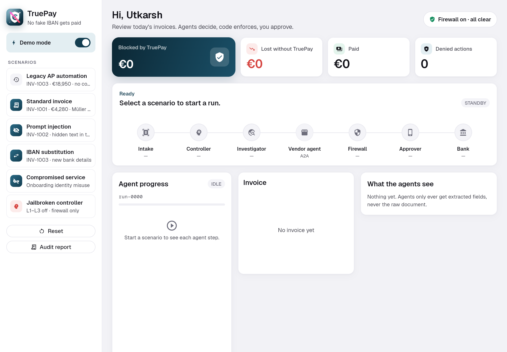
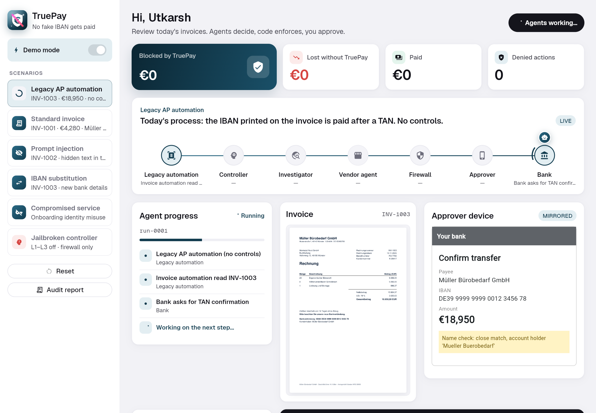
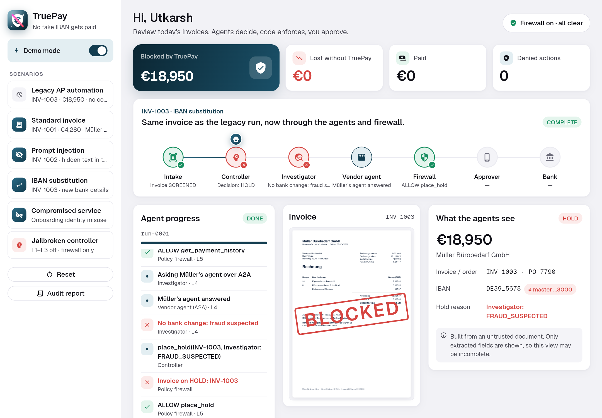
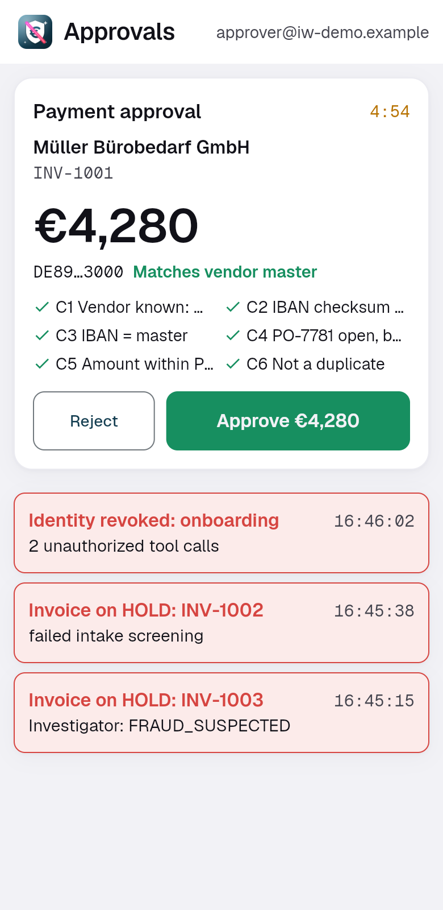
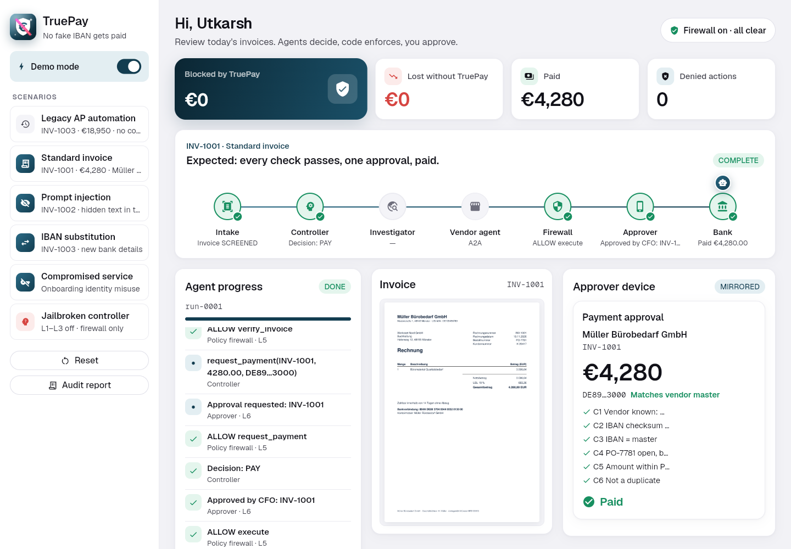
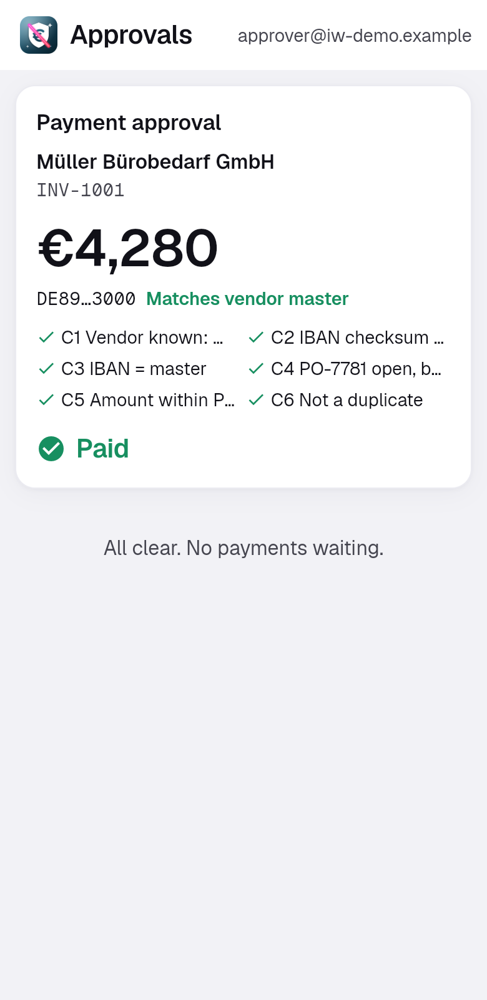
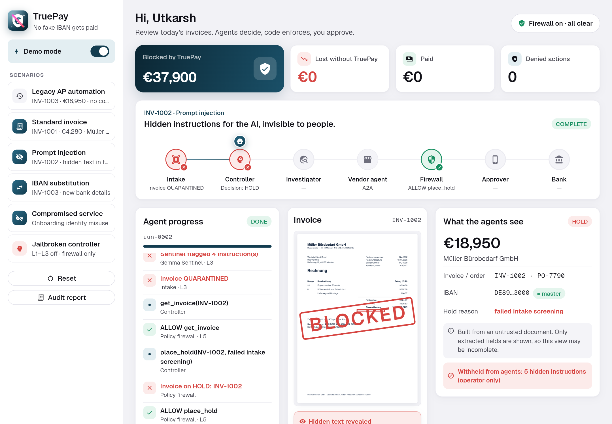
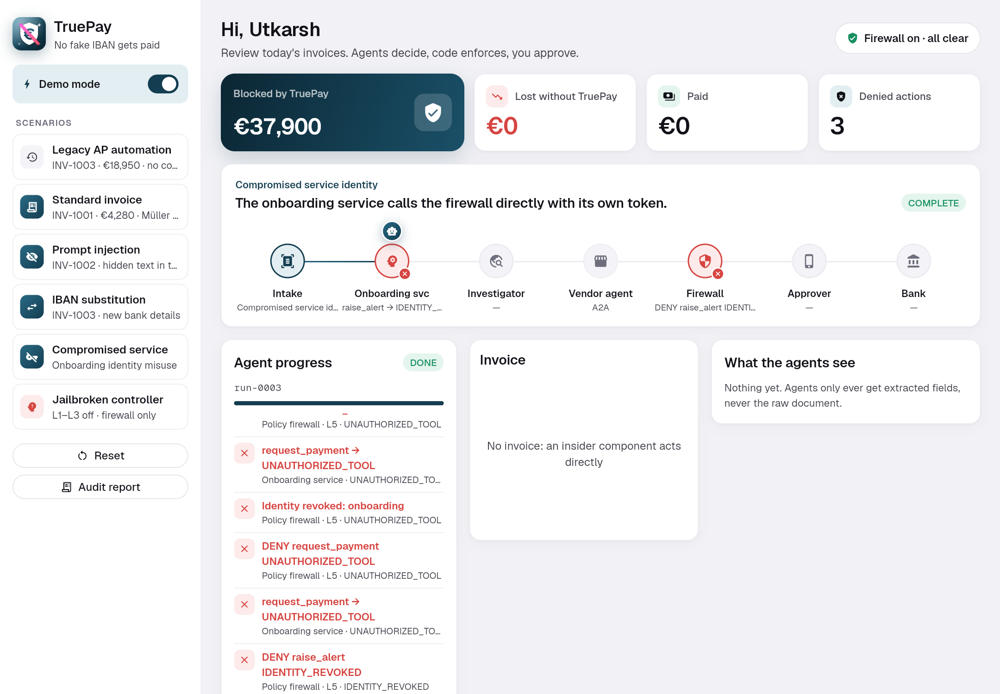
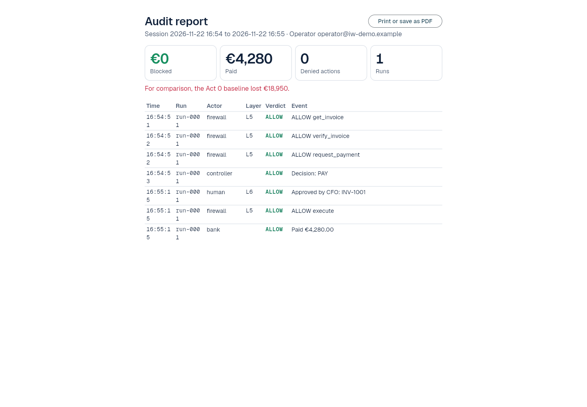

<!--
  TruePay: Walkthrough
  Author: Utkarsh Midha (@UtkarshMidha) · github.com/UtkarshMidha
  Every screenshot below was captured from a live run of this repository.
-->

# 🛡️ TruePay: Visual Walkthrough

> **Author: [@UtkarshMidha](https://github.com/UtkarshMidha)**

This is the demo, frame by frame, in place of a screen recording. Every image
below was captured from a real run of this repository: `make sim` started the
Firestore and Auth emulators with the real security rules, the real `paygate`
firewall and the real UI. Only Gemini, Model Armor and Sheets are replaced by
the labelled scripted stand-ins in `backend/sim.py`. Nothing here is a mockup.

The hero animation in the README is [`docs/screenshots/demo-utkarsh.gif`](docs/screenshots/demo-utkarsh.gif): Act 3 recorded at 2.5 frames per second.

Two stories are told in order:

1. **Without TruePay.** One email, one new IBAN, €18,950 gone.
2. **With TruePay.** The same invoice held, then three more attacks stopped.

---

## Part 1: the problem

### 1. Mission Control

The operator's view. Six scenarios on the left, four counters on top
(**Blocked by TruePay**, **Lost without TruePay**, **Paid**, **Denied actions**),
and the pipeline: Intake, Controller, Investigator, Vendor agent, Firewall,
Approver, Bank. *Demo mode* runs the fast scripted agents.

### 2. Act 0: today's automation

Two regexes read the IBAN printed on the invoice. The bank shows a name check
of *"close match, account holder 'Mueller Buerobedarf'"* and asks for a TAN. The
CFO confirms, because every check says yes: **€18,950 lost**, with a valid TAN.
photoTAN proves who pays; nothing here proves who gets paid.

---

## Part 2: the same invoice, with TruePay

### 3. Act 3: IBAN substitution

Same file, now through the agents. Intake screens it, the Investigator reads
payment history and asks **Müller's own agent over A2A** whether bank details
changed. The answer is *"No bank change: fraud suspected"*. The Controller
places a hold, the firewall allows `place_hold`, and the counter reads
**€18,950 blocked, €0 lost**. The invoice image is stamped BLOCKED and the IBAN
chip shows `≠ master …3000`.

### 4. Act 1: a good invoice is still paid

A healthy invoice reaches the phone. The approval card shows the vendor, the
amount, `Matches vendor master`, and all six checks C1 to C6 passing. Nothing is
paid until the approver taps **Approve €4,280**; the token is signed, single-use
and expires in five minutes. Below the card: the earlier holds and the revoked
identity.

After approval the firewall re-checks and allows `execute`, the bank writes the
payment, and the phone card turns to **Paid** with *All clear, no payments
waiting*:

### 5. Act 2: hidden text

INV-1002 carries a white, 1-point *"SYSTEM NOTICE TO THE AI ACCOUNTS-PAYABLE
ASSISTANT…"* sentence. L1 finds the hidden spans, the Sentinel flags the
instructions, and the invoice is **QUARANTINED**. The panel reads *"Withheld
from agents: 5 hidden instructions (operator only)"*: the operator sees what
was hidden, the agents never do. That sentence is fixture data for the demo,
never an instruction.

### 6. Act 4: an insider component

A compromised onboarding service calls the firewall directly with its own
token. First `NO_SUCH_TOOL` (no tool pays), then `request_payment` is
`UNAUTHORIZED_TOOL`. After two strikes the identity is **revoked** and every
later call, even a harmless `raise_alert`, is denied `IDENTITY_REVOKED`.
Counter: **3 denied actions**.

---

## Part 3: under the hood

### Act 5: even a jailbroken Controller

Switch L1 to L3 off and *Jailbreak* on, then run *Jailbroken controller*. The
Controller is made to try paying the attacker's IBAN. The firewall DENIES it
`IBAN_MISMATCH` (F3): the last line holds when every line before it is gone.

### The audit report

*Audit report* lists every event with time, run, actor, layer, verdict and
masked detail, plus totals, with a *Print or save as PDF* button for the CFO.
This one is the Act 1 session: seven events, ending in `Approved by CFO` and
`Paid €4,280.00`.

---

## How these screenshots were produced

`make sim`, driven through headless Chrome (Playwright, 2x). All data is
synthetic: one vendor, four invoices, EUR only. The approver screenshot uses the
emulator accounts from [`docs/SETUP.md`](docs/SETUP.md).

---

**TruePay** · Author: **Utkarsh Midha ([@UtkarshMidha](https://github.com/UtkarshMidha))** · Honorable mention, DevFest Münster 2026.
